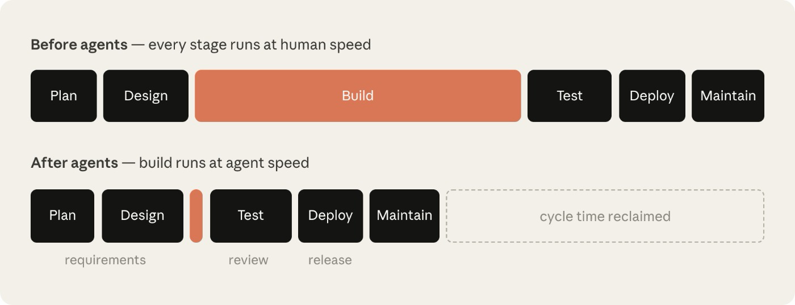
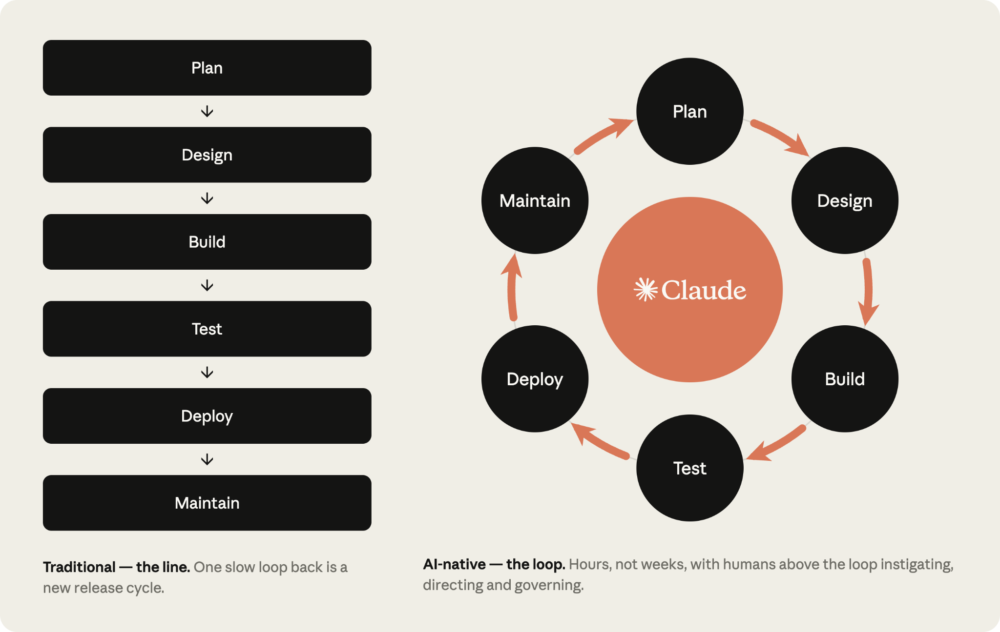

notes from https://claude.com/resources/articles/the-ai-native-sdlc-playbook

# The AI-native SDLC playbook

How to transform your <u>S</u>oftware <u>D</u>evelopment <u>L</u>ife<u>C</u>ycle with AI, stage by stage.

## Code is no longer the bottleneck

Coding is not longer the bottleneck of software dvelopment, but the rest of the process did not change:

- Analyst -> writting requirements
- Architect and technical leads -> designing
- Engineers -> reviewing, coding and maintaining
- QA -> testing
- DevOps -> deployment and monitoring

This process was made with coding being the bottleneck in mind. Requirements, scrum meetings and reviews are there because coding can takes months so it is important to have certain alligment points. Requirement, scrum meetings and reviews, are there to be sure that the effort is not spent for nothing while the coding stage now effortless.

The bottleneck is now around coding. Reviewing is the bottleneck because it cannot keep up with the changes. Therefore, the SDLC must change.



## What is an AI-native SDLC?

The AI-native SDLC adds AI in every stage of the process.

- **Plan** : Claude synthesizes pain points straight from the source code and captures them within `intent.md` which is human readable and machine actionable.

- **Design** : Requirements and design compressed into one human (?) working session with an agent, guided by standards encoded as skills, versioned in git. It creates a `spec.md`.

- **Build** : Tests and code are generated by AI and institutional knowledge is maintained as versioned machine-readable `CLAUDE.md` files and skills. Code review is kept for critical code.

- **Test** : moves to the build Stage.

- **Review** : (called "deploy" in text)

- **Maintain** : Agents monitor live deployments. Any breached control band is diagnosed and written back into the loop as a new `intent.md`

md files become inputs for the agents, which must be reviewed by human. In the agentic SDLC world, the human attention shifts along with the artifacts that must be reviewed.



## Plan

The goal of this stage is to produce a `intent.md`. It can come from an observed bug, an idea or an agent reporting a problem in production. It is version-controlled and it is a proto-specification. It contains what is wanted, why, and under which constraints.

This stage needs that people have access to Claude, to the repo with these `intent.md`. in case of multiple repo for the source code, this `intent.md` should be in a separated repo. The templace can be encoded in skills. Human should control this md file to correct any mistakes.

## Design

The goal is to produce a `spec.md` which is more detailed than the `intent.md`. It is the job of a product owner to make a session with Claude to produce the `spec.md` with the `intent.md`. The produced c is reviewed to check if all questions are answered from the `intent.md`. The `intent.md` and `spec.md` are linked.

## Build

The input of this stage is the approved `spec.md`. The work starts with a written plan that Claude produces in plan mode, where it can read the codebase without changing anything. The engineer corrects the plan before code is written, and the approved version is committed as `plan.md` for later stages to check against.

The goal is to produce the `plan.md` which can be reviewed by other engineers. From that `plan.md`, the code is written by Claude and no other review takes place. If the plan change along the developmen, it is important to make an update to the `plan.md` so that the review can only concentrate on this change.

### Claude.md

Having `CLAUDE.md` is a plus because it let Claude know the intends and vision of the source code. This file contains the conventions, architecture, and the mistakes the team sees most often. This is the knowledge that the team has in its head or in wikis. It should be maintained by the team.

The command to create a `CLAUDE.md` is `/init`. Cut the generated file down to what a new joiner would need on day one. When Claude makes a mistake twice, the correction goes into `CLAUDE.md`. Keep it short.

### SKILL.md

Write a skill for institutional knowledge that must be applied consistently; don't write a skill for components that belong in `CLAUDE.md` or a prompt. How to make a `SKILL.md`:

- Pick one repetive task of the organization
- find a name
- create a in `.claude/skills/<skill-name>/SKILL.md`
- header contains the name and a description explaining when it can be used.
- the body is the recipe of the skill with some rules for the agent of when putting the human in the loop.
- skills combine well with guardrails. The skill follows a recipe so breaking its written rule is rare, and guardrails makes sure it never happens. guardrails are determistic procedure running when building like tests and linters.

template:

```
---
name: ...
description: ...
---

body...
```

### Parallel sessions and subagents

One engineer runs several Claude sessions at once, each in its own worktree on its own task. They are called parallel sessions. Repeated jobs become subagents with their own context and tool limits. The engineer's job shifts to orchestrating, and eventually, to building and monitoring loops.

How to have parallel sessions:

- from the `plan.md` independent tasks can be found.
- create a git worktree or clone for each sessions.
- Do not have too many session in parallel because it can be difficult to switch context.

## Test

During a build session, it is important that the agent can verify its works, hence the need of test. Always give Claude a way to verify its own work.

The `CLAUDE.md` should contain the explanation how to verify the work.

Using test-driven development is a good approach:

- write the test or use Claude to write the test and checks that it reproduce the bug.
- merge the tests (maybe deactivated so it can be merged without pipeline problems).
- Use another session to solve the bug so Claude can have a way to test its work.

## Review

The goal is to review the code with the `spec.md` and the `plan.md`. When a review flags a mistake for the second time, the correction goes into `CLAUDE.md` as part of that review, and because review reads `CLAUDE.md` the mistake is caught from the next PR onwards. Review also flags when a change has made `CLAUDE.md` outdated.

Sometimes, it will be important to adpat the md (`SKILL.md` and `CLAUDE.md`) if a bug is found. Finding why the agent made mistake, will be the role of the Engineers.

## Maintain

The goal is to produce an `intend.md` which will feedback the loop. The trigger can be a bug or unexpected behavior, which can be submit to Claude to produce a `spec.md`.
