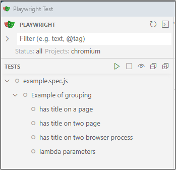

From [https\://learning.oreilly.com/course/playwright-testing-with/9781808728419/](https://learning.oreilly.com/course/playwright-testing-with/9781808728419/)

# Setup

## First project

To create a blank test project:

```
npm init playwright@latest
```

to run the test

```
npx playwright test
```

to see the report, there should be a playwright-report html file at the root or run:

```
npx playwright show-report
```

See in action with a ui. This ui shows every step

```
npx playwright test --ui
```

## ESLint

It is recommended to install the VS code extension ESLint. Also execute the following command which will install it on all project.

```
npm install -g eslint
```

Initialize ESLint on the project

```
npx eslint --init
```

# Core Concepts Browser, Context, Page, Fixtures

## Fixtures \- Page, Context, Browser

A **page** is a fresh tab in a fresh browser and is only accessible in the test:

```js
import { test, expect } from '@playwright/test';

test('has title', async ({ page }) => {
  await page.goto('https://playwright.dev/');

  // Expect a title "to contain" a substring.
  await expect(page).toHaveTitle(/Playwright/);
});
```

A **context** is an isolated browser session, which can create pages. Cookies and local storage are owned by the context, so two page of the same context share the same Cookies and local storage.

```js
import { test, expect } from "@playwright/test";

test("has title on two page", async ({ context }) => {
  const page1 = await context.newPage();
  const page2 = await context.newPage();

  await page1.goto("https://playwright.dev/");
  await page2.goto("https://playwright.dev/");

  await expect(page1).toHaveTitle(/Playwright/);
  await expect(page2).toHaveTitle(/Playwright/);
});
```

The **browser** always to create multiple context with separate cookies and local storage.

```js
import { test, expect } from "@playwright/test";

test("has title on two browser process", async ({ browser }) => {
  const context1 = await browser.newContext();
  const context2 = await browser.newContext();

  const page1 = await context1.newPage();
  const page2 = await context2.newPage();

  await page1.goto("https://playwright.dev/");
  await page2.goto("https://playwright.dev/");

  await expect(page1).toHaveTitle(/Playwright/);
  await expect(page2).toHaveTitle(/Playwright/);
});
```

Those three lambda parameter are related to each other, so by default, we get one page of a context of a browser:

```js
import { test } from "@playwright/test";

test("lambda parameters", async ({ page, context, browser }) => {
  console.log(page.context() == context); // true
  console.log(browser == context.browser()); // true
});
```

## Structure of a Spec File

**test.describe** groups the tests

```js
// @ts-check
import { test, expect } from "@playwright/test";

test.describe("Example of grouping", () => {
  test("has title on a page", async ({ page }) => {
    ...
  });

  test("has title on two page", async ({ context }) => {
    ...
  });

  test("has title on two browser process", async ({ browser }) => {
    ...
  });

  test("lambda parameters", async ({ page, context, browser }) => {
    ...
  });
});
```

In the ui, the test are grouped:  


## Before and After Hooks

There are after and before hooks:

- **test.beforeAll** is executed before all tests of the same worker
- **test.beforeEach** is executed before each test
- **test.afterEach** is executed after each test
- **test.afterAll** is executed after all tests of the same worker

```js
// @ts-check
import { test, expect } from "@playwright/test";

test.describe("Example of grouping", () => {
  test.beforeAll(async () => {
    ...
  });

  test.beforeEach(async () => {
    ...
  });

  test.afterEach(async () => {
    ...
  });

  test.afterAll(async () => {
    ...
  });

  test("has title on a page", async ({ page }) => {
    ...
  });

  test("has title on two page", async ({ context }) => {
    ...
  });
});
```

## Test steps

test.step simply groups a test into logical steps. It is convenient to add a small title to each logical step.

```js
import { test, expect } from "@playwright/test";

test("has title on two page", async ({ page }) => {
  await test.step("navigate", async () => {
    await page.goto("https://playwright.dev/");
  });

  await test.step("assert", async () => {
    await expect(page).toHaveTitle(/Playwright/);
  });
});
```

# Test runner basics

## Tags

use tag to annotate the tests. For instance, we can annotate them by feature so we can run the relevant test if the feature is impacted. To add tags, simply add “@\<tagName\>” at the end of the title of a test.

Some rules:

- keep number of tags short. Do not add a tag for every bug.
- put tags at the end of the test title. Do not add tags behind a helper function.
- group test of the same feature inside the same folder

```js
// @ts-check
import { test, expect } from "@playwright/test";

test.describe("tags", () => {
  test("test 1 @test1", async ({ page }) => {
    ...
  });

  test("test 2", { tag: ["@test2"] }, async ({ page }) => {
    ...
  });
});
```

## VS code test explorer

To change the testing folder, go to the test tab add scroll to the configuration to choose an alternative “[playwright.config.js](http://playwright.config.js)”

It is also possible to run the tests on other browsers, if they are configured in the “[playwright.config.js](http://playwright.config.js)”.

We can also show the browser while the test is running.

Running a test step-by-step is also possible, in debug mode by using the red mark on the left.

In watch mode, changing a test makes the test re-running.

## Running playwright command

From the folder were the config file is, we can run the following command to run all tests:

```
npx playwright test
```

running one spec file, is done by pointing at the spec file from the config file folder. Mind the / iso \\:

```
npx playwright test tests/example.spec.js
```

running all test in a folder, is very similar:

```
npx playwright test tests
```

running with the test name. \-g stands for grep. it will run any test containing this string after \-g.

```
npx playwright test -g "has title on two page"
```

Running one tag:

```
npx playwright test --grep @test1
npx playwright test --grep "@test1|@test2"
```

We can ask to view the browser with \--headed. It is advised to run one test.

```
npx playwright test --headed tests/example.spec.js
```

to run with one browser

```
npx playwright test --project=chromium
```

to have only one worker:

```
npx playwright test --workers=1
```

debug mode:

```
npx playwright test tests/example.spec.js --debug
```

## Annotations

We can **skip** a test by adding skip in the test. it can be in a test with a condition.  
**fixme** does the same.  
**test.slow()**, marks a test as slow and triple the timeout time.  
**only** will skip all other of the group.  
the **annotation** object contains a list or one annotation object with two properties “type” and “description”.

```js
// @ts-check
import { test, expect } from "@playwright/test";

test.describe("annotations", () => {
  test.skip("test 1", async ({ page }) => {
    ...
  });

  test.fixme("test 2", async ({ page }) => {
    ...
  });

  test("test 3", async ({ page }) => {
    ...
  });

  test("test 4", async ({ page }) => {
    test.slow();
    ...
  });

  test.only("test 5", async ({ page }) => {
    ...
  });

  test("test 6", async ({ page }) => {
    test.skip(browserName == "firefox", "not supported");
    ...
  });

  test(
    "test 7",
    {
      annotation: {
        type: "issue",
        description: "test-suite",
      },
    },
    async ({ page }) => {
      await page.goto("https://playwright.dev/");

      // Expect a title "to contain" a substring.
      await expect(page).toHaveTitle(/Playwright/);
    },
  );
});
```

## Reporter

The html page which opens is the reporter. We can change its configuration in the playwright.config.js, in the reporter property.  
See doc [https\://playwright.dev/docs/test-reporters](https://playwright.dev/docs/test-reporters)

We can change this report. It can be a list, a json, an html, junit (xml), …

```js
// @ts-check
import { defineConfig, devices } from "@playwright/test";

export default defineConfig({
  ...
  /* Reporter to use. See https://playwright.dev/docs/test-reporters */
  reporter: [
    ["list"],
    ["html"],
    ["junit", { outputFile: "./junit-report/result.xml" }],
  ],
  ...
});
```

## npm custom script

Of course, you can add the test in the script part of the package.json.

```json
{
  ...
  "scripts": {
    "test": "playwright test",
    "test-ui": "playwright test --ui"
  },
  ...
}
```

##

